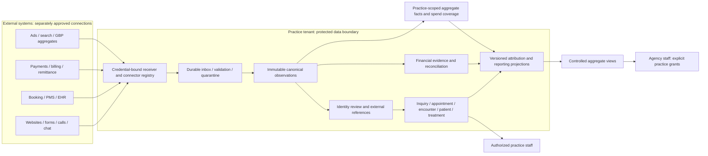
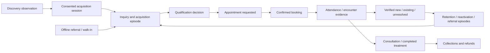

# B — Universal patient journey and connector boundaries

> **Execution status:** [PROJECT_STATE](../PROJECT_STATE.md) is authoritative for the current milestone, validation and authorization. Phase 2B is merged in PR #4; Phase 2C is next and unstarted at the October 20, 2026 checkpoint. Architecture 0.2.0 and A01–A10 remain unchanged; Group B/C remain pending. Dated adoption, validation and publication statements below are historical specification records, not current implementation status or new authorization.


> **Historical adoption record 1 — superseded by approval record 2:** The owner accepted design **0.2.0 as the technical baseline**, subject to unresolved policy approvals in J. This supersedes the earlier “final validation draft / technical approval pending” status only. Proposed policy defaults remain pending. Phase 2A planning is authorized; implementation and GitHub publication actions are not. See [adoption and Phase 2A handoff](I-roadmap.md#adoption-and-phase-2a-handoff) and [owner approval register](J-product-decisions.md#group-a-owner-approval-register).


Design 0.2.0 · Technical baseline and narrow A01–A10 approved; Group B/C pending.
**Proposed design.** A patient journey is an evidence graph with independently progressing facts, not a single mandatory funnel status. People can skip stages, pay before treatment, return years later or have no measurable digital discovery.



No anonymous advertising identifier becomes a patient identity merely by entering this graph. Aggregate marketing facts have no patient join key. Agency portfolios combine only authorized, appropriately suppressed aggregates; they never bypass tenant RLS.



Arrows express possible links, not proof of causation or obligatory ordering. Payments may precede attendance; verification may arrive after treatment. Store each event's effective time and ingestion time. No-show/cancellation branches retain booking history and do not become attendance. A referral creates a distinct episode without copying another patient's medical history.

## Ownership and lifecycle

| Area | Authoritative responsibility | Allowed relationship |
|---|---|---|
| Agency/client operations | Agency registry and explicit client grant | An agency manages practices but does not own a universal patient directory. |
| Practice | Existing Org tenant | Locations and websites belong to one practice; shared domains require explicit route-to-practice mapping. |
| Website/content | Website registry; later CMS publishing module | Service taxonomy and page versions can be attached to acquisition observations; publishing is separate from patient permission. |
| Anonymous discovery | Consented, minimized first-party observations | No Contact/Patient required; short retention and no fingerprinting. |
| Inquiry | Confirmed submission, inbound call/chat or staff entry | An episode may have multiple inquiries and candidate identities; unlinked is valid. |
| Qualification | Authorized staff/provider-backed decision | Qualified, disqualified or pending; not equivalent to clinical need. |
| Scheduling | Configured source per appointment/location | Request, confirmation and changes are distinct; all revisions preserved. |
| Attendance/patient status | Approved clinical/PMS authority plus coverage | Check-in is not automatically completed attendance or newness. |
| Treatment | Minimal approved clinical outcome evidence | Service, completion and time; no chart text by default. |
| Money | Source transaction plus reconciliation decision | Separate recorded, provider-verified, settled and reconciled layers. |
| Retention | Subsequent episodes and existing patient status | Repeat revenue never silently becomes new-patient acquisition. |

## Connector manifest — required before an adapter is enabled

Each manifest must declare: vendor/product/API version; supported canonical event/schema versions; provider account namespace and stable object keys; per-object read/write capabilities; auth method and required scopes; tenant/location routing rules; webhook signature/replay rules; polling cursors and pagination; history limits; rate/burst limits and Retry-After behavior; sandbox/contract entitlement; timezones and clock precision; status-to-canonical mapping; authority level by field; currency/sign conventions; refunds/chargebacks; correction and deletion semantics; completeness limitations; consent/PHI classification; secret rotation; revocation handling; health checks; backfill behavior; mapping version; fixture and acceptance-test coverage; operational owner and vendor deprecation watch.

A capability is `documented`, `contract-confirmed`, `sandbox-tested`, `practice-validated`, `unsupported`, or `unknown`. Do not promote the connection as universally verified. Example: a connector can be practice-validated for bookings, unknown for attendance and unsupported for settled cash.

Methods include REST, FHIR, authorized HL7 interfaces, webhooks, polling, approved CSV/SFTP, licensed middleware and audited manual entry. FHIR availability does not establish billing or appointment access. HL7 transport and message versions must be agreed with the practice/vendor; no hospital listener or direct database connection is assumed. CSV imports require file digest, batch ID, source provenance, stable row keys, dates/currency, validation report and coverage interval. Manual entries use the same canonical vocabulary with `staff_asserted` evidence.

## Delivery boundary

```mermaid
sequenceDiagram
  participant Vendor
  participant Receiver
  participant PG as PostgreSQL
  participant Worker as Celery worker
  participant Review
  Vendor->>Receiver: Signed delivery / scoped service request
  Receiver->>Receiver: Validate credential, tenant, schema and size
  Receiver->>PG: Atomic inbox + processing work row
  PG-->>Receiver: Commit
  Receiver-->>Vendor: Durable acceptance receipt
  Worker->>PG: Claim due row under practice context
  Worker->>PG: Recheck authorization, deduplicate and reconcile
  alt Sufficient identity and authority
    Worker->>PG: Atomic canonical fact + effect + processing result
  else Missing or conflicting evidence
    Worker->>PG: Keep accepted observation; block projection
    Worker->>Review: Restricted review item
  end
```

Redis/Celery is a wake-up mechanism; PostgreSQL is the durable work record. A sweeper recovers committed work if publication to Celery fails. Vendor-specific acknowledgments may use a documented 2xx status; they always mean accepted for processing, not completed booking, verified attendance or settled payment. Invalid requests receive non-success without normal canonical side effects.

Each source is separately replaceable. Keep historical provider namespaces and identities after disconnection. A replacement adapter maps new IDs through evidence-backed decisions; identical numeric IDs across vendors are not the same patient. Replay uses the original adapter/schema/mapping version or an explicit reviewed migration, never silently the newest mapping.


## Authoritative specification ownership

D defines canonical entities, event names, schema/ingestion/replay states and module ownership. E defines identity and attribution decision semantics. F defines financial predicates and KPI populations. G defines proposed authorization/privacy controls, while [current permissions](../patient-permissions.md) remains the implemented baseline. C states researched provider capabilities, not domain policy. H supplies acceptance oracles, I sequences implementation and J records pending choices. Examples may abbreviate prose but must use D's event names in fixtures; a new connector maps to these definitions rather than redefining them.

Source references and financial identities include D3's incarnation when required. Human identity/financial review is independent of connector administration. Full source-to-revenue proof spans phases 2–6; the initial phase 2 foundation proves durable observation processing without pretending later patient verification/reporting exists.
